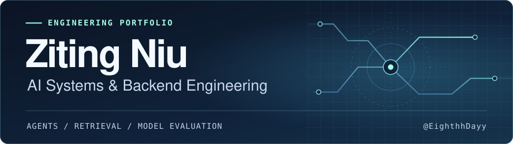

I build **LLM applications and Python backends**, from agents that call authenticated tools to retrieval pipelines that cite their sources. I hold an **M.S. in Computer Science** from San Francisco Bay University.

[Selected work](#selected-work) · [Open-source work](#open-source-work) · [Technical stack](#technical-stack)

## Selected work

### 01 / AI Task Manager

**An agent backend for task automation and document Q&A.** I built the FastAPI service from scratch, with authenticated task operations, a stdio MCP server, and a RAG pipeline backed by PostgreSQL/pgvector. Redis/RQ workers handle PDF ingestion and OCR outside the request cycle.

[Source code](https://github.com/EighthhDayy/ai-task-manager) · [System architecture](https://github.com/EighthhDayy/ai-task-manager#system-architecture) · [MCP demo](https://github.com/EighthhDayy/ai-task-manager/blob/main/docs/mcp.md)

### 02 / Transformer-Based Question Answering

**A study of extractive and generative QA on SQuAD 2.0.** I compared DistilBERT with Qwen3-0.6B and fine-tuned Qwen3 using 4-bit QLoRA. On an 80-example pilot, token F1 rose from **29.20% to 60.44%**, alongside more false abstentions on answerable questions.

[Source code](https://github.com/EighthhDayy/Transformer-Based-Question-Answering-System) · [Evaluation results](https://github.com/EighthhDayy/Transformer-Based-Question-Answering-System#qwen3-qlora--observed-results)

### 03 / Automotive Sales Decision Support

**An applied ML project for vehicle sales.** I combined XGBoost budget prediction, K-means customer segmentation, KNN vehicle recommendations, and a pricing simulation.

[Source code](https://github.com/EighthhDayy/Automotive-Budget-Prediction-and-Pricing-Model)

## Open-source work

**OpenAI Codex (Rust)** · In my fork, I patched remote compaction to surface the actual fallback error and added regression coverage. [View the patch](https://github.com/EighthhDayy/codex/pull/1)

## Technical stack

- **AI systems** · LLM tool calling, MCP, RAG, vector retrieval
- **Model adaptation and evaluation** · PyTorch, Transformers, TRL, QLoRA
- **Backend engineering** · Python, FastAPI, PostgreSQL/pgvector, Redis/RQ, Docker, pytest
